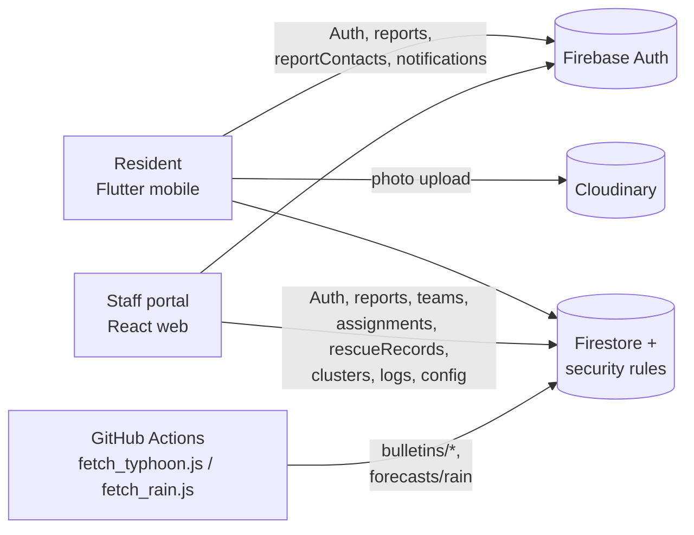

# FinalProject_DRRM — System Flow

End-to-end flow of the **Disaster Rescue Reporting & Monitoring System**: who acts, on which
surface, what data is written, and how the incident moves from report to rescue to closed.

> Companion docs: [`ERD.md`](ERD.md) (data model), [`USER_MANUAL.md`](USER_MANUAL.md) (per-role
> how-to), [`DEMO_SCRIPT.md`](DEMO_SCRIPT.md) (recording script),
> [`DEFENSE_NOTES.md`](DEFENSE_NOTES.md) (FR map, rationale, gaps).

---

## 1. System at a glance

| Surface | Built with | Actors |
|---|---|---|
| Resident app | Flutter (`mobile/`) | **Resident / reporter** |
| Staff portal | React + Vite + Tailwind (`web/`) | **Dispatcher**, **Rescue team**, **DMO**, **Admin** |
| Backend | Firebase **Auth + Firestore** (security rules = the backend) | — |
| Media | Cloudinary (unsigned upload) | resident photos |
| Feeds | JMA / GDACS (typhoon), Open-Meteo (rain), PAGASA bulletins | read-only |
| Maps | MapLibre GL + OpenStreetMap / MapTiler | — |

There is **no application server**. All logic runs client-side; integrity, role checks and PII
gating are enforced in `firestore/firestore.rules`.

---

## 2. Architecture



Data flows **resident → Firestore → dispatcher → rescue team → reporter**, with Firestore
realtime listeners replacing polling on every screen.

---

## 3. Roles & permissions

| Role | Surface | Capabilities |
|---|---|---|
| `resident` | mobile | register, submit reports + PII contact, track own reports, receive notifications |
| `dispatcher` | web | read all reports/clusters/teams/assignments, verify / reject / duplicate, assign teams (single, backup, cluster), close incidents |
| `rescueTeam` | web | read assignments, accept / decline / start / complete, read PII **only while `users.teamId == reports.teamId`** (or backup) |
| `dmo` | web | analytics + reports/export, read the audit log |
| `admin` | web | superuser + account management (Staff/Users) + writes `config/dispatch` |

Hierarchy `resident < dispatcher < rescueTeam < dmo`, with `admin` as superuser. `active:false`
is a global kill switch (checked in rules and at web login). The web portal is **staff-only** —
residents are blocked at login (`web/src/pages/Login.jsx`).

---

## 4. Data model (summary — full list in `ERD.md`)

| Collection | Key fields | Written by |
|---|---|---|
| `users/{uid}` | `role`, `active`, `profile{}`, `teamId` | mobile register; admin/staff |
| `reports/{id}` | `reporterId`, `disasterType`, `lat/lng`, `geohash`, `imageUrls[]`, `status`, `priority`, `teamId`, `backupTeamIds[]`, `clusterId`, `verifiedBy`, `rejectionReason`, `history[]` | resident create; staff/responders update |
| `reportContacts/{reportId}` | victim name/contact, relationship, special needs, notes (**PII**) | resident; staff |
| `teams/{id}` | `name`, `contact`, `status`, `memberUids[]` | dispatch |
| `assignments/{id}` | `reportId`\|`clusterId`, `teamId`, `status`, `backup`, `dispatchedBy` | dispatch; rescue team (status) |
| `rescueRecords/{id}` | `assignmentId`, `peopleRescued`, `notes`, `recordedBy` | rescue team |
| `clusters/{id}` | `center`, `cell`, `reportIds[]`, `priority`, `status` | dispatch |
| `notifications/{id}` | `userId`, `title`, `body`, `read`, `type`, `reportId` | staff (to reporter); resident ping (to dispatchers) |
| `logs/{id}` | `uid`, `action`, `details` (append-only) | any signed-in user |
| `config/dispatch` | `dispatcherUids[]` | admin |
| `bulletins/*`, `forecasts/rain` | feed payloads | Admin SDK scripts only |

---

## 5. Report status lifecycle

```
Submitted → Under Verification → Verified → Awaiting Assignment
          → Team Assigned → Rescue in Progress → Resolved → Closed

Terminal (never rescued further): Rejected, Duplicate, Cancelled
```

| Transition | Who |
|---|---|
| create → `Submitted` | resident (mobile only) |
| → `Verified` (+`verifiedBy`) | dispatcher/admin |
| → `Rejected` (+`rejectionReason`) | dispatcher/admin |
| → `Duplicate` | dispatcher/admin |
| → `Team Assigned` | dispatcher/admin on assignment |
| → `Rescue in Progress` | rescue team (start) |
| → `Resolved` | rescue team (complete → writes `rescueRecords`) |
| → `Closed` | dispatcher/admin (from `Resolved` only) |

Transitions are validated server-side by rules (`validStatus`) and restricted by role.

---

## 6. End-to-end happy path

```mermaid
sequenceDiagram
  autonumber
  participant Res as Resident (mobile)
  participant FS as Firestore (rules)
  participant Dis as Dispatcher (web)
  participant Team as Rescue team (web)

  Dis->>FS: sign in (email/pw) — role checked against WEB_ROLES
  Res->>FS: register (phone → synthetic email) — users/{uid} role=resident
  Res->>FS: submit reports/{id} status=Submitted + reportContacts/{id} (PII)
  Res->>FS: notifications/* type=new_report → each config/dispatch uid
  FS-->>Dis: realtime bell badge + toast + sound (ReportAlerts)
  Dis->>FS: Verify (verifiedBy) / Reject(reason) / Mark duplicate / set priority
  Dis->>FS: assign team → assignments{dispatched} + reports.teamId + status "Team Assigned"
  Dis->>FS: (optional) add backup team → reports.backupTeamIds[] + backup assignment
  FS-->>Team: assignment appears in responder queue
  Team->>FS: accept → in_progress (report → "Rescue in Progress"; PII unlocks)
  Team->>FS: complete → rescueRecords{peopleRescued} + report → "Resolved"
  Dis->>FS: close incident → "Closed"
  FS-->>Res: notifications on verify/reject/assign/progress/resolved
```

**Numbered flow**

1. **Provisioning** — admin creates staff accounts (`StaffPage`) and resident logins
   (`UsersPage`); the dispatcher list `config/dispatch.dispatcherUids` is kept in sync so mobile
   pings route correctly.
2. **Resident signup / login** — phone number is normalized to `+63…`; Auth uses a synthetic
   email `<digits>@drrm.local`; the profile is written to `users/{uid}` with `role:"resident"`.
3. **Report submission** — disaster type, description, GPS or manual pin, up to 3 Cloudinary
   photos, people affected, and a "for myself / for someone else" PII block. Writes `reports`
   (`status:"Submitted"`, `priority:"medium"`, `geohash`, `history:[Submitted]`),
   `reportContacts/{id}`, and a fixed-shape `new_report` notification to each dispatcher.
4. **Dispatcher triage** — bell badge + toast + sound; the dispatch map and list show active
   incidents ranked by waiting time. Verify, reject-with-reason, or mark duplicate.
5. **Assignment** — to a single report, an additional **backup** team, or a suggested **cluster**
   → `assignments` doc(s), `reports.teamId` / `backupTeamIds`, status `Team Assigned`, team
   status `assigned`, reporter notified.
6. **Response** — rescue team: `dispatched → accepted → in_progress → completed`. Start sets
   `Rescue in Progress` and unlocks PII for the assigned team(s); complete writes
   `rescueRecords` and sets `Resolved`.
7. **Close & monitor** — dispatcher closes `Resolved → Closed`; DMO builds analytics + CSV/PDF;
   admin reviews the append-only audit trail.

---

## 7. Rescue priority — time-based (no severity)

Priority is **derived from submission time**, not from a manual severity value
(`web/src/pages/dispatch/constants.js`, `DispatchPage.jsx`):

- Active (non-terminal) reports are ranked oldest → newest; the **oldest = #1 ("Next rescue")**.
- Waiting-time buckets drive pin/list colors: **`>6h` red · `3–6h` amber · `1–3h` yellow ·
  `<1h` blue**.
- The rank recomputes live as reports resolve/close. There is no manual `low/medium/high` input
  in the web UI (the stored `priority` field remains for schema/mobile compatibility).
- **Terminal** reports (`Resolved, Closed, Rejected, Duplicate, Cancelled`) are excluded from the
  map and from the default **Active** list, and their actions are disabled.
- Clusters and the DMO "open reports by waiting time" chart use the same age buckets.

---

## 8. Detailed example — "Typhoon Uwan, Bulacan" (2026-10-25)

**Cast:** Maria (resident), Pedro (resident), Nyle (dispatcher), *Pulilan Rescue* (Alpha),
*Malolos Rescue* (Bravo), R. Santos (admin).

| Time | Actor | Action → data written | FR |
|---|---|---|---|
| 08:00 | Admin | Creates dispatcher **Nyle** and teams **Alpha**/**Bravo**, sets `teams.memberUids`, updates `config/dispatch` | FR-01, FR-13 |
| 18:40 | Maria | Registers: phone `+639171234567` → Auth `<digits>@drrm.local`; `users/{uid}` profile (Malolos, Sto. Niño) | FR-01 |
| 20:00 | Maria | Submits **R1** (Flood, 14.8559/120.8114, 2 photos, "for someone else" M. Cruz, elderly) → `reports/R1 {status:"Submitted"}` + `reportContacts/R1` + `new_report` pings | FR-02, FR-03, FR-04 |
| 20:00 | System | Rescue queue: **R1 = #1** | FR-06 |
| 20:01 | Web | Nyle's bell + toast + sound (`ReportAlerts`); opens Dispatch | FR-09 |
| 20:03 | Pedro | Submits **R2** Flood ~90 m away → flagged **possible duplicate**; queue **R1 #1, R2 #2** | FR-14 |
| 20:05 | Nyle | **Verifies R1** → `Verified` + `verifiedBy`, notifies Maria; **marks R2 Duplicate** → R2 leaves map/list | FR-05, FR-14, FR-15 |
| 20:07 | Nyle | Assigns **Alpha** to R1 → `assignments/A1 {dispatched}`, `reports/R1.teamId`, status `Team Assigned`, `teams/Alpha.status="assigned"` | FR-07 |
| 20:10 | Nyle | Adds **backup Bravo** → `assignments/A2 {backup:true}`, `reports/R1.backupTeamIds=["Bravo"]`; rules grant Bravo PII access too | FR-07, §8 |
| 20:15 | Alpha | Accepts A1 → `accepted`; **Start** → `in_progress`, R1 → `Rescue in Progress`, PII (`reportContacts/R1`) unlocked | FR-08, FR-11 |
| 20:35 | Bravo | Declines A2 → `declined` (removed from active responder queue) | FR-07 |
| 21:00 | Alpha | **Complete** → `rescueRecords/RR1 {peopleRescued:4}`, A1 → `completed`, R1 → `Resolved`, notifies Maria | FR-11 |
| 21:05 | Nyle | **Close incident** → R1 → `Closed`; leaves the active queue/map | FR-05 |
| 21:10 | DMO | Analytics: open-by-waiting-time donut, avg time-to-verify/resolve, rescued count; CSV/PDF export | FR-12 |
| — | Admin | **Activity** shows the append-only chain: `auth_login`, `staff_created`, `report_verify`, `report_duplicate`, `report_assign`, `report_assign_backup`, `assignment_accept`, `assignment_start`, `assignment_decline`, `assignment_complete`, `report_close` | FR-13 |

---

## 9. Edge cases (as implemented)

- **Reject a dispatched report** → assigned teams returned to `available`, open `assignments`
  set `cancelled`, `teamId`/`backupTeamIds` cleared, `rejectionReason` written, reporter
  notified, detail panel closes, incident leaves the active list/map.
- **Mark duplicate** → same release path, `status:"Duplicate"`.
- **Backup team** → primary `teamId` retained, extras stored in `backupTeamIds`; each backup
  gets its own assignment doc; the PII gate in rules accepts the primary **or** any backup team.
- **Cancelled assignments** → excluded from the rescue team's active queue/counts.
- **Clusters** → client-side "suggested clusters" (≥2 active reports in ~1 km grid cells);
  assigning creates `clusters/{id}` and one assignment, and marks member reports `Team Assigned`.
- **Duplicate detection** → keys on `disasterType + ~110 m cell + 24 h` (grid approximation);
  dispatch confirms before marking `Duplicate`.

---

## 10. Implemented vs. planned (reality check)

These appear in the README/manual roadmap but are **not yet in the code**:

| Described as | Current reality |
|---|---|
| Offline-first queue / "pending sync" badge | **Not implemented** — no local queue/connectivity code in `mobile/lib` |
| "Send via SMS" fallback | **Not implemented** — `url_launcher` declared but unused; `phone.dart` only normalizes numbers |
| FCM push notifications | **Not implemented** — notifications are Firestore-only + in-app (web bell/toast, mobile screen) |
| Report markers / clustering on the mobile map | **Not implemented** — the mobile map renders hazard/weather overlays only |
| 4 mobile tabs | Actually **2 tabs** (Map, Profile) + center Report FAB + top-right notification bell |

Fully implemented: the web flow (dispatch / responder / DMO / admin), Firestore rules, seeds,
feeds, and the time-based priority, backup-team and terminal-report handling described above.

---

## 11. Where it lives (file map)

| Concern | Path |
|---|---|
| Resident auth / report submit | `mobile/lib/core/auth_service.dart`, `core/report_service.dart` |
| Resident screens | `mobile/lib/screens/` (login, register, home_shell, report, map_tab, notifications, profile) |
| Web auth + guards | `web/src/core/auth/*`, `web/src/core/guards/ProtectedRoute.jsx` |
| Dispatch (triage/assign/priority) | `web/src/pages/dispatch/DispatchPage.jsx`, `ReportMap.jsx`, `constants.js` |
| Responder | `web/src/pages/responder/ResponderPage.jsx` |
| DMO analytics | `web/src/pages/dmo/DmoPage.jsx` |
| Admin (staff/users/activity) | `web/src/pages/admin/*` |
| Firestore access (services) | `web/src/core/services/*` |
| Security rules | `firestore/firestore.rules` |
| Feeds | `scripts/fetch_typhoon.js`, `scripts/fetch_rain.js` |
| Rules tests | `scripts/rules-test/` |
